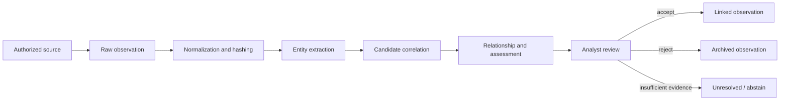

# Correlation Pipeline

## Evidence boundary

DHRUVA distinguishes a raw observation from an analytical interpretation. A raw observation stores retrieved content, source context, collection time, method, reliability, extracted entities, and a SHA-256 content hash. A candidate actor link, relationship, confidence label, or attribution score is an interpretation derived from that record; it is not rewritten as source evidence.

## Implemented signals

| Signal | Current implementation | Interpretation caution |
|---|---|---|
| Identity | Handle similarity, shared wallets, and PGP identifiers | Reuse, impersonation, and planted identifiers can create false links |
| Infrastructure | Shared domains, services, indicators, certificate fingerprints, and graph overlap | Shared hosting and common services weaken exclusivity |
| Behavioral | Posting-hour histograms | Sparse timestamps and timezone assumptions can distort similarity |
| Stylometric | Nine normalized text features | Short, translated, copied, or deliberately altered text is unreliable |
| Semantic | Mean sentence-transformer embeddings and cosine similarity | Topic similarity is not identity similarity |
| Temporal | Timeline ordering and activity distributions | Co-occurrence alone does not establish a relationship |

The original weighted semantic, stylometric, behavioral, handle, and graph fusion remains available as a comparison baseline. The active decision layer converts observations into atomic evidence, collapses copied lineage, applies rarity/quality/freshness weighting, evaluates contradictions and deception flags, and either supports the link or abstains. Exact parameters are versioned in `config/reliability.yaml`.

## Supporting and contradicting evidence

New assessments persist both supporting and contradicting evidence. Strong contradictions veto a link; credible conflict yields `CONTESTED`; sparse support yields `INSUFFICIENT`; and deception risk yields `TAINTED`. Shared infrastructure alone is explicitly blocked. See [reliability engine](reliability-engine.md) for the decision contract and arithmetic.
