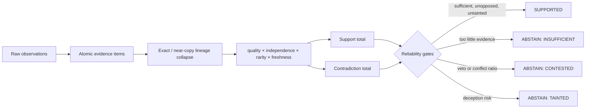

# Reliability engine

DHRUVA retains its original weighted semantic/stylometric/behavioral/handle/graph score as **Baseline A**. The live decision is now made by a separate, explainable reliability engine configured in [`config/reliability.yaml`](../../config/reliability.yaml).

## Evidence and lineage

Each atomic evidence row records its type, two subjects, value, source, observation/validity timestamps, content hash, origin, derivation flag, and raw reference. Exact hashes and near-duplicate long text collapse to their earliest origin. Derived copies remain visible but receive an independence factor of zero, so three mirrors cannot become three corroborating sources.



## Weight calculation

For evidence item `i`:

`weight_i = base_weight(type) × quality_i × independence_i × rarity_i × freshness_i`

- Quality is constrained to 0–1 and represents provenance/source quality.
- Independence is 1 for a lineage root and 0 for derived copies.
- Rarity is inverse persona frequency for exact identifiers; common identifiers contribute little.
- Freshness decays exponentially using a type-specific half-life. Infrastructure has the shortest window.
- Known shared infrastructure receives the configured contribution cap.

Supporting and contradicting totals are reported independently. A strong contradiction is a veto rather than a subtraction. The response includes the complete per-item arithmetic, config version, gate names, baseline result, and degraded-mode flag.

## Decision contract

Every new assessment returns:

```json
{
  "decision": "SUPPORTED | ABSTAIN",
  "abstain_reason": "INSUFFICIENT | CONTESTED | TAINTED | SHARED_INFRA_ONLY | null",
  "confidence_band": "LOW | MEDIUM | HIGH",
  "support": 0.0,
  "contradiction": 0.0,
  "items": [],
  "gates_triggered": []
}
```

`DEGRADED_MODEL` is always emitted when the embedding/model path is unavailable, and degraded mode cannot produce a high confidence band. An analyst override never erases this result; it creates an audit-log entry with the user and required justification.

## Contradictions and deception risk

The engine accepts enumerated temporal, PGP/exclusive-identifier, infrastructure-window, stylometric, and wallet-class conflicts. Strong instances veto support. Known exchange, mixer, service, and donation wallets are treated as shared services rather than identity proof.

Measurable deception flags include a copied identifier, a later-created lookalike, a handle typosquat, and low-reliability single-source evidence. Two flags, or one flag on dominant evidence, trigger `TAINTED`.

## Evaluation

Run `python scripts/evaluate.py`. It creates a seeded synthetic benchmark (60 cases), compares Baseline A with the engine, reports false-link rate/precision/recall/coverage, produces a precision-versus-coverage curve, and performs independence/rarity/shared-discount/veto ablations.

The benchmark deliberately exercises known failure families. It is synthetic and must not be presented as a measurement of real-world deanonymization accuracy.
